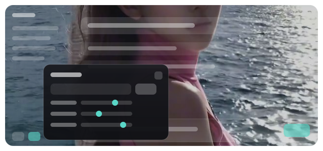

# 绕过抖音接口关死 · 解析抖音视频给 agent

## 姊妹项目 · DSH 抖音壁纸插件

**粘贴一条抖音链接，DSH 的极简界面就变成它的播放背景：视频铺满窗口，界面像磨砂玻璃浮在上面。**

[](https://github.com/yangyanlu06/dsh-douyin-wallpaper)

插件在本仓库取流方法之上做了两层：`lapian_bridge.py` 的事件驱动等待（见下文「实测坑位」第 1 条），
以及把整段界面变成半透明玻璃的 Web 端。→ [dsh-douyin-wallpaper](https://github.com/yangyanlu06/dsh-douyin-wallpaper)

---
抖音把官方接口对服务端读者关死之后，把一条分享链接变成可播放 mp4 的唯一稳定路子：
**headless Edge（playwright + 系统 Edge）**，取页面自己 XHR 里的 `video.play_addr`。
本仓库是新版实现 + 一份实测记录，供 agent 直接调用。

```
python lapian_bridge.py "<整段分享口令>" --out ./out
```

成功时最后一行输出（其它输出都在它之前，可按前缀过滤）：

```json
__DWP_JSON__{"ok": true, "mp4": "/abs/out/dy_7708…mp4",
  "meta": {"aweme_id": "…", "page_url": "https://www.douyin.com/video/…",
           "title": "…", "duration": 13.77, "width": 576, "height": 1024,
           "src_kind": "api", "api_play_urls": 66, "bytes": 442590}}
```

失败时同样是一行，`ok` 为 `false`，`reason` 是人话（失败即停，不重试）：

```json
__DWP_JSON__{"ok": false, "reason": "[STOP] 未拿到播放直链…"}
```

## 为什么不能直接抓

| 路 | 结果（2026-11 实测） |
| --- | --- |
| 分享页 `iesdouyin.com/share/video\|note/<id>/` 的 `_ROUTER_DATA` | `videoInfoRes` / `noteInfoRes` 都是 `null`，整页没有 `play_addr` |
| `aweme/v1/web/aweme/detail/` 直接请求 | `403 ArgusSecurityPlugin` |
| `iesdouyin.com/web/api/v2/aweme/iteminfo/` | 200 但空 body |
| 自己注册 `ttwid` + 桌面 UA 抓 PC 页 | 只拿到 72 KB 空壳；浏览器会话才有 900 KB+ hydrated 文档，而它的 `RENDER_DATA` 只有 app 配置，没有 aweme 数据 |
| yt-dlp | 缺 ttwid / 签名，走不通 |

结论：**必须以真实浏览器会话的身份去请求**，并在页面自己发出 `/aweme/v1/web/` 请求后把 JSON 拿下来。

## 它怎么工作

1. `playwright.chromium.launch(channel="msedge", headless=True)` —— **headless Edge 不触发验证码**（agent-browser 会被拦，这是关键差别）；
2. 打开分享链接，监听所有 `/aweme/v1/` 响应，收集 JSON；
3. 从 JSON 里递归找 `url_list` 中属于视频 CDN 的地址（`douyinvod` / `bytecdn` / `snssdk`…，排除 `douyinpic` 图片域名），按 `qs` 参数挑最高档（`qs=0`）；
4. 带页面 cookies 用 requests 一次性下载；
5. 没有 API 命中时的兜底顺序：network 里的 CDN 媒体请求 → `<video>.currentSrc`。

## 与 `douyin_lapian.py` 的关系

`douyin_lapian.py` 是完整拉片流水线（下载 + 分镜 + 逐帧指标 + 联系表），取流部分用的是同一套方法。
本仓库的 `lapian_bridge.py` 复用它的 `play_urls_from_blobs` / `pick_best_src` / UA / `state.json`，
只把「固定等 4.2 秒」换成「轮询等播放源（默认 25 秒上限）」，并只做取流与下载。

## 实测坑位（按遇到概率排序）

1. **固定等待会误报**。原脚本 `page.wait_for_timeout(4200)` 之后立刻读，实测这台机上：
   4.2 s 时 `video` 元素 0 个、`/aweme/v1/` 响应 0 条；9 s 才出现 `aweme/detail` 与 `currentSrc`。
   所以要等事件，不要等固定秒数。
2. **详情 XHR 落在 `www-hj.douyin.com`**，不是 `www.douyin.com`；按 host 全等过滤会漏。
3. **`/slides/<id>` 是混合轮播**（同一界面里多个视频、各自进度条）：服务端渲染对爬虫是 404，必须走浏览器；它会被重定向到 `/note/<id>`。
4. **图文（`/note/`）没有视频**：要拿正片图，用 `Baiduspider` UA 直接 GET `www.douyin.com/note/<id>`，HTML 里有 `~tplv-dy-aweme-images` 的地址（真实格式常是 webp）。
5. **搜索页会触发验证码**（`captcha=True`），视频页/图文页不会。
6. `image-cut-tos-priv/…:330` 是推荐位缩略图，不是帖子正片；图文页里的 `<video>` 可能是推荐位自动播放，不能当成本帖视频。
7. 短链会过期、作品会被删：视频页可能 302 到 `douyin.com/jingxuan?previous_page=web_video_404_link`。
8. 下载到的 mp4 常没有 `duration` 元数据可用（页面 `<video>` 还没就绪）：用 OpenCV 读容器补。

## 环境

```
uv venv && uv pip install playwright opencv-python numpy pillow requests scenedetect
python -m playwright install msedge   # 或直接用系统已装的 Edge
```

Python 3.12 实测可用（playwright 1.65.2 / opencv 5.0 / numpy 2.5.5 / scenedetect 0.7.3）。

## 给 agent 的调用约定

- 输入：整段分享口令（含中文、emoji、尾部口令都行），只取里面第一个 `http(s)` 链接；
- 输出：只解析最后一行 `__DWP_JSON__` 前缀的 JSON，**不要**把前面的进度输出当结果；
- 超时：给 180–240 秒（首次冷启动 Edge 约 8–12 秒）；
- 失败语义：`ok=false` 就是最终结论，**不要重试、不要换第三方接口重投**（会污染账号风控）；
- 产物：`--out` 目录下的 `dy_<aweme_id>.mp4`。

## 不做什么

不逆向签名、不去水印、不批量爬取、不并发轰炸。失败即停。

